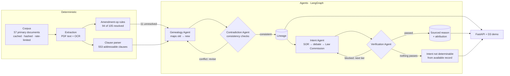

# OpenSansad

**A multi-agent system that traces how Indian law changes, clause by clause, and why, with
every claim quoted from a primary source and attributed to whoever made it.**

**▶ Live demo: https://rishitudikeri3-rgb.github.io/openSansaad/**: click a story card, or any
section of the Act. It runs in the browser; nothing to install.

---

## The problem

When Parliament amends a law, it doesn't publish a new version. It passes an *amending Act*: a
list of instructions such as *"in section 37, in sub-section (1), for clauses (a) and (b), the
following clauses shall be substituted"*. To know what the law says today, and how it got there,
you must apply decades of such instructions by hand. To know **why** each change was made,
you must find the Government's Statement of Objects and Reasons, the parliamentary debate,
or a Law Commission report, and read them.

India Code publishes the *current* text with footnotes, but not the history: which old clause
a new one descends from, what was renumbered, what was inserted and later removed, or the
reasons. Lawyers, journalists and students reconstruct this by hand.

OpenSansad does it automatically for the **Arbitration and Conciliation Act, 1996**, through
its 2015, 2019 and 2021 amendments: **105 amendment operations, 48 provisions, 57 primary
source documents**.

## Why this needs agents (and not a single LLM call)

A retrieve-and-summarize pipeline fails here for three concrete reasons, each visible in the demo:

1. **Lineage is a judgment call.** In 2015, clauses (a) and (b) of s.37(1) were replaced by
   three clauses (a), (b), (c). Pairing by label gives (a)→(a), (b)→(b), which is wrong: the old
   (a) became the new **(b)**, and a new (a) was inserted. Only reading the text tells you.
2. **The system must revise its own conclusions.** A mapping that looks right in isolation can
   contradict later evidence. The system needs a loop that detects contradictions and sends
   decisions back for revision.
3. **The system must know when to stop.** Some amendments are explained in the Statement of
   Objects and Reasons, some only in debate, some nowhere. The system should escalate through
   sources and, if nothing qualifies, **refuse** rather than invent a plausible reason.

**Design principle: deterministic code for mechanical work, agents only where judgment is
required, and every agent output is checked before it is kept.**

## Architecture



| Component | Kind | What it does |
|---|---|---|
| Corpus + cache | code | Fetches from e-Gazette, sansad.in, the Parliament Digital Library, PRS and the Law Commission through **one** rate-limited, robots-respecting cache. Raw bytes are never overwritten; every file is SHA-256 hashed and its provenance logged. |
| Extraction | code | PDF text layer with per-page OCR fallback; running heads, margin notes, footnotes and legacy-font Hindi handled explicitly. |
| Clause parser | code | Turns the 1996 Act into a tree of stable IDs (`s34.ss2.cl(b)` = s.34(2)(b)), stored in PostgreSQL and Neo4j. |
| Amendment-op rules | code | Reads formulaic instructions ("for the words X, the words Y shall be substituted"). Anything ambiguous is left **unresolved** with a reason, never guessed. |
| **Genealogy Agent** | LLM | Maps unresolved operations. It chooses only among candidates the parser built, and invalid answers are re-asked with the problems listed. |
| **Contradiction Agent** | code + LLM | Deterministic checks (text similarity across a mapping, a clause claimed twice, dangling references, wrong scope) raise conflicts; a model judges each one, and confirmed conflicts go back to the Genealogy Agent. |
| **Intent Agent** | LLM | Escalating search over evidence tiers. It may only *quote*: a passage, verbatim text and a one-sentence claim. |
| **Verification Agent** | code + LLM | Blocks a claim unless its quote is found verbatim in a primary document, the speaker is not the Chair, and a reviewer model confirms that the quote states a *reason* for *this* amendment and the claim adds nothing. |

## A worked example: the system correcting itself

Section 37(1), 2015 amendment, run with the small (20B) model first:

1. **Genealogy Agent, first pass:** old (a) → new (a), old (b) → new (b), new (c) inserted.
   Plausible, and wrong.
2. **Contradiction Agent:** the `mispaired` check measures text similarity across every mapping.
   New (b) is **1.00** similar to old (a) but only **0.43** to old (b), the clause it was mapped
   from. Conflict raised; the reviewer model (120B) confirms it and names the group for revision.
3. **Genealogy Agent, revision** (given the findings): old (a) → new (b), old (b) → new (c),
   new (a) inserted. **Correct.**
4. Second round: no conflicts. Loop ends.

## A worked example: refusing to guess

The 2015 change to s.36 (abolishing the automatic stay of awards) is shown as **"intent not
determinable from available record"**. The Intent Agent's SOR candidate was blocked by the
reviewer ("not about this amendment"), and no debate or report passage passed verification. The
system doesn't paraphrase something plausible; it shows nothing, and lists the sources it searched.

## Results

**Genealogy**: scored against a hand-built answer key for all 104 lineage edges of the three
amending Acts. The 11 "hard" edges, in 6 instruction groups, are those the rules cannot decide.

| System | All edges P / R | Hard edges P / R | Hard groups | Revisions |
|---|---|---|---|---|
| Rules only | 1.000 / 0.904 | 1.000 / 0.091 | 1/6 | – |
| Label pairing (naive baseline) | 0.952 / 0.962 | 0.583 / 0.636 | 3/6 | – |
| Single pass, 20B | 0.981 / 0.981 | 0.818 / 0.818 | 5/6 | – |
| Single pass, 120B | 1.000 / 1.000 | 1.000 / 1.000 | 6/6 | – |
| **Agentic, 20B first pass + loop** | **1.000 / 1.000** | **1.000 / 1.000** | **6/6** | **1 (wrong → right), 0 right → wrong** |

The loop lets a **cheap model match the expensive one**: the large model is called only to
adjudicate conflicts and revise, not for every decision.

**Intent and verification**: 42 amendment units:

| | |
|---|---|
| Sourced with a verbatim, attributed quote | **26 (62%)**: SOR 17 · debate 6 · Law Commission 3 |
| Attributed to | Government 17 · Members of Parliament 6 · Law Commission 3 |
| Draft claims blocked by verification | 26 |
| Refused ("not determinable") | 16 |
| Refusals checked by hand | 7 justified · 6 probably justified · **3 misses** (reasons exist in sources the ranking missed) |

## What makes it trustworthy

- **Provenance on everything.** Every clause, operation, mapping and quote points to a source
  document row and a character span, and every file is hashed.
- **Attribution, not "objectivity."** Reasons are reported as *who said it, where*. A Member's
  speech is never presented as the Government's position, and the model never decides who spoke:
  attribution comes from the document's speaker labels.
- **Refusal over fabrication.** A claim without a citable primary source is blocked, not softened.
- **Reproducible offline.** Every model call is cached on disk, keyed by model and prompt, at
  temperature 0, and the cache is committed: the whole evaluation re-runs with no API key.
- **Tested.** 263 offline tests; network access is blocked during tests, and an AST check enforces
  that only the cache module may touch the network and only one module may call a model.
- **Free and open models only.** gpt-oss-120b / 20b (open weights) on Groq's free tier, behind
  an OpenAI-compatible interface, so any provider or a local Ollama model works.

## Honest limitations

- **One Act, so there is no held-out data.** Two fixes were designed after seeing errors on this
  Act, so the genealogy scores are optimistic. A second Act (Prevention of Corruption Act, 1988)
  is the next step.
- On this Act the large model alone also scores 6/6; the loop's value shown here is cost
  (cheap first pass), not accuracy over the best single model.
- The answer key and base-text transcription were model-checked; a full human pass is pending.
- Intent search ranks passages lexically, which caused all three misses; semantic retrieval is planned.
- Per-provision commencement dates and court judgments (s.87, struck down in 2019) are not yet
  part of the lineage.

## Run it locally

Requires [uv](https://docs.astral.sh/uv/) and Docker.

```bash
cp .env.example .env      # USER_AGENT contact; LLM_* only needed to re-query models
make install              # uv sync (Python 3.12)
make up && make migrate   # postgres, redis, neo4j
make demo                 # http://127.0.0.1:8000
make test                 # 263 offline tests
python -m opensansad.eval.genealogy      # genealogy evaluation (replays from cache)
python -m opensansad.workflows.intent    # intent + verification (replays from cache)
make site                 # static export of the demo (published on gh-pages)
```

Write-ups: [`docs/recon.md`](docs/recon.md) (source and Act selection),
[`docs/phase1-ingestion.md`](docs/phase1-ingestion.md),
[`docs/phase2-genealogy.md`](docs/phase2-genealogy.md),
[`docs/phase3-intent.md`](docs/phase3-intent.md). Architecture, rules and every design decision
with its reason: [`CLAUDE.md`](CLAUDE.md).

## Roadmap

Second Act and a held-out evaluation · court judgments and commencement notifications as
lineage events · semantic retrieval for intent · Rajya Sabha debates and Hindi OCR · bill
metadata 2006 onward and session summaries · a chatbot that answers only from sourced
records · React front end.

---

*Agentic AI course project, 7th semester, AI & Data Science, BMS College of Engineering.*
